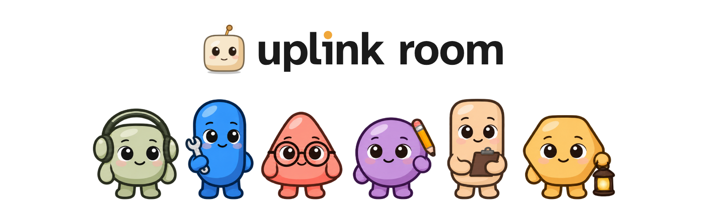
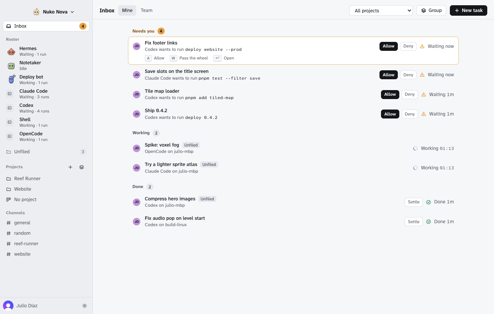
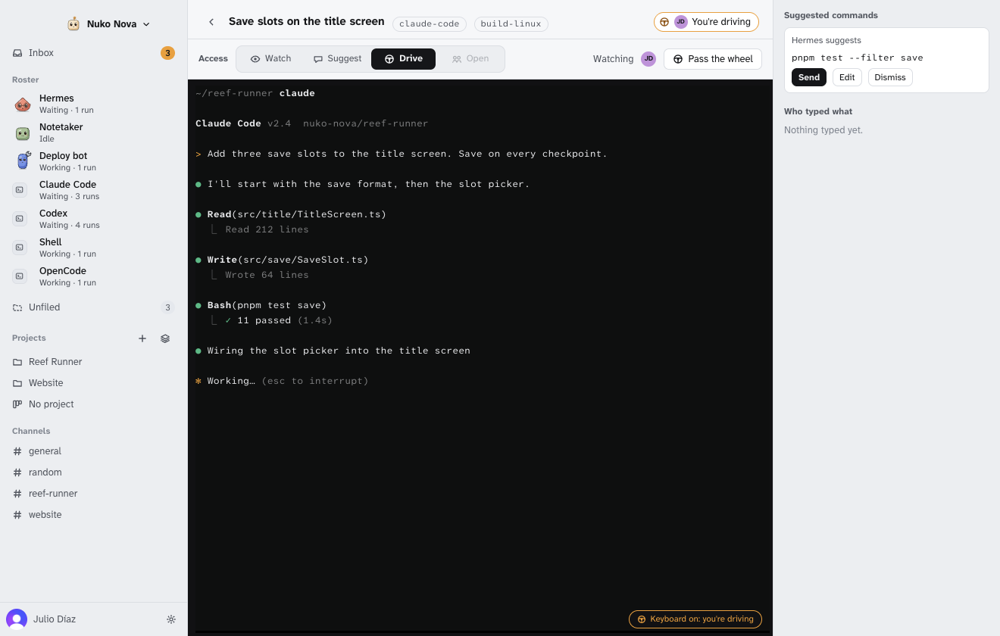
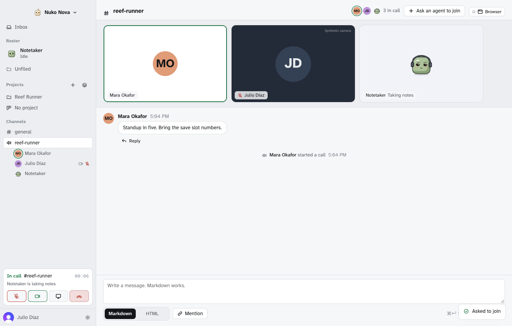
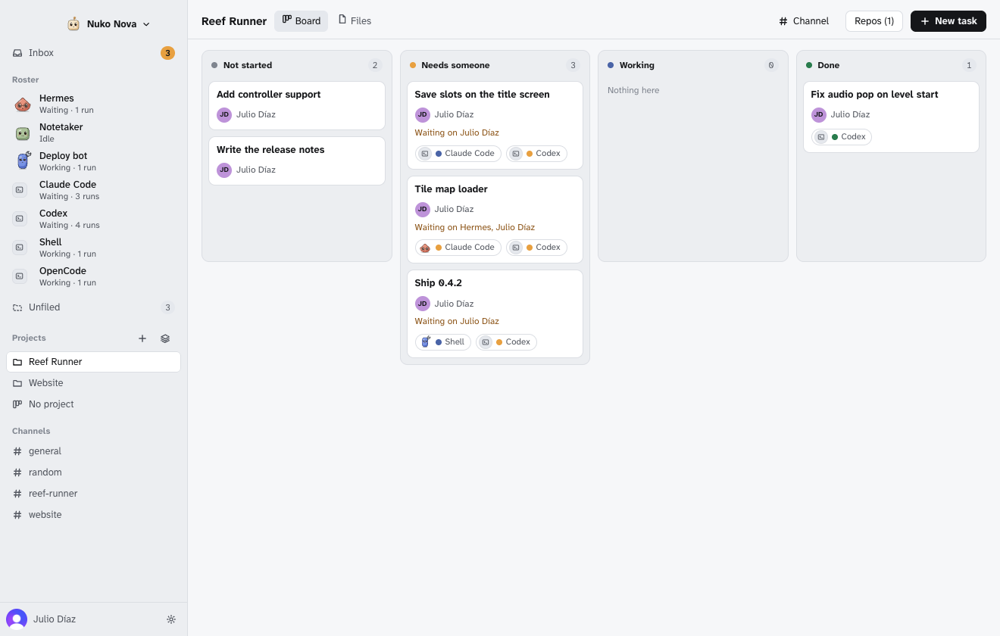

<p align="center">
  <picture>
    <source media="(prefers-color-scheme: dark)" srcset=".github/assets/banner-dark.png">
    
  </picture>
</p>

<h3 align="center">One room for your team and all of its agents.</h3>

<p align="center">
  <a href="https://uplinkroom.com/download"><b>Download for macOS, Windows and Linux</b></a>
</p>

<p align="center">
  <a href="https://github.com/nuko-nova-dynamics/uplink-room/actions/workflows/ci.yml"></a>
  <a href="LICENSE"></a>
</p>

Uplink Room is a desktop app for teams that work with coding agents. It connects the agents you already use to channels, calls and projects, and gives each person one Inbox: what needs you, what's working, and what's done.

It doesn't run agents itself. Claude Code, Codex and the others run on your own machines, signed in with your own accounts, and a small bridge on each machine shares their terminals with the team.

<picture>
  <source media="(prefers-color-scheme: dark)" srcset="apps/site/public/screens/44-inbox-needs-you-live-dark.png">
  
</picture>

<sub>The Inbox, with sample work. Codex wants to run a deploy and waits until someone allows it.</sub>

## Take the wheel

The bridge shares each machine's terminals with the team. One person drives at a time; everyone else watches or suggests a command, and the driver can pass the wheel.

Whoever the machine belongs to decides how far anyone may go on it: Watch, Suggest, Drive or Open. The bridge enforces that limit on the machine itself.

<picture>
  <source media="(prefers-color-scheme: dark)" srcset="apps/site/public/screens/05-terminal-dark.png">
  
</picture>

<sub>Claude Code at work on build-linux. Hermes suggested a command; the driver decides whether it runs.</sub>

## Calls with your agents in them

Voice, video and screen sharing happen in a channel. Ask the Notetaker to join and it transcribes the call on one of your own machines, posts call notes when the call ends, and proposes tasks. A proposed task becomes a task only when someone on the team accepts it.

<picture>
  <source media="(prefers-color-scheme: dark)" srcset="apps/site/public/screens/24-call-stage-dark.png">
  
</picture>

<sub>A call in #reef-runner, with the Notetaker taking notes.</sub>

## Projects that keep their own board

A project is an optional group of tasks with a channel of its own. Its board has four columns that come from the runs on each task: Not started, Needs someone, Working and Done. Nobody drags cards. A card moves when one of its agents changes state.

<picture>
  <source media="(prefers-color-scheme: dark)" srcset="apps/site/public/screens/02-board-dark.png">
  
</picture>

## What it works with

| | |
|---|---|
| **Coding agents** | Claude Code, Codex, Grok Build, OpenCode and Cursor, in T3 Code threads or in a shared terminal |
| **Terminals** | A plain shell, tmux, herdr or Rex, shared by the bridge on each machine |
| **Team agents** | Hermes, OpenClaw and other agents that speak A2A. Each one is added by a person and can do at most what that person can. |
| **Desktops** | Cua Spaces on machines you own, with one driver at a time |
| **Browsers** | Shared browsers in a channel, which can keep their logins for as long as you choose |
| **Files** | Markdown docs, canvases, PDFs and images, with comments pinned to the exact spot |
| **Cloud machines** | Team Linux machines that start when work needs them and stop once they're idle |

Agents and scripts can do everything the app does through the Room API: `packages/room-client` ships a TypeScript client, an MCP server (`uplink-mcp`) and a CLI (`uplink`).

## Run it from source

You need Node 24 or newer and pnpm (the version pinned in `package.json`).

```sh
pnpm install
pnpm --filter @uplink-room/backend dev     # a local Convex backend
pnpm --filter @uplink-room/desktop dev     # the app, against that backend
```

Copy `apps/desktop/.env.example` to `apps/desktop/.env.local` first. `apps/desktop/README.md` covers sign-in, packaging and the rest.

Before you open a pull request, run the checks CI runs:

```sh
pnpm lint && pnpm typecheck && pnpm test
pnpm specs     # the TLA+ models; needs Java 11 or later
```

## What's in the repo

| Path | What it is |
|---|---|
| `apps/desktop` | The Electron app: Inbox, project boards, shared terminals, machines, agents, channels and calls |
| `apps/site` | uplinkroom.com: what the app does, downloads and the update feed |
| `packages/backend` | The Room API, on Convex. Every action in the app goes through it (ADR 0003). |
| `packages/bridge` | Shares a machine's terminals with the room and enforces that machine's local limits |
| `packages/room-client` | The TypeScript client, MCP server and CLI for the Room API |
| `packages/notetaker` | The agent that transcribes calls and proposes tasks (ADR 0008) |
| `packages/protocol` | Code shared by the bridge, the backend and the room client |
| `specs/` | TLA+ models of the room's concurrent parts |
| `GLOSSARY.md` | The project's vocabulary: which word to use for each concept, and which to avoid |
| `DESIGN.md` | The design system: color, type, the Inbox, conversations, calls, characters and sound |
| `docs/adr/` | Decisions that are hard to reverse, with the reason for each |
| `design/`, `concept/`, `research/` | The design rounds, the first concept page and the research behind them |

## Why the name

It comes from the uplink room at NASA's JPL, where the Curiosity team sends commands to its rover.

## Contributing

Issues and pull requests are welcome. Start with [CONTRIBUTING.md](CONTRIBUTING.md). Report security problems privately, as [SECURITY.md](SECURITY.md) describes.

## License

[MIT](LICENSE), © 2026 Nuko Nova Dynamics LLC.
